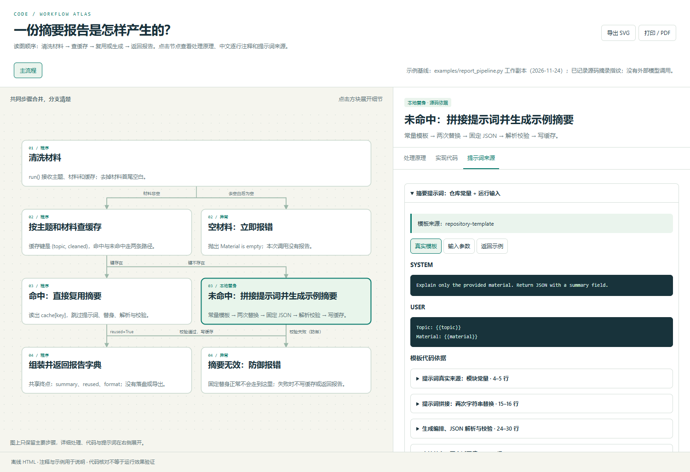

# Code Workflow Atlas · 代码工作流图解 Skill

把一个项目的代码整理成**可点击的 HTML 流图**，用于向老师汇报、代码讲解和架构交接。

- 总览只保留主要步骤，共同流程合并，实际分叉单独画出。
- 点节点，在旁边查看输入、处理、输出与后续去向。
- 原始源码与中文注释切换，保留文件、版本、行号和摘录指纹。
- 展示提示词模板、参数来源、拼接示例与返回结构。
- 可按固定版本并排比较两套实现，区分已核对差异和待实测影响。
- 单个 HTML 离线打开，支持键盘选择、手机布局、SVG 导出及打印。

这是一个帮助 AI 阅读代码并制作说明的 skill：语义梳理由使用 skill 的 AI 完成，脚本负责抓取指定源码、校验数据和渲染页面。脚本不会自动理解全部代码，也不会调用大模型。



## 安装

从 [Releases](https://github.com/2239052231xiaochong/code-workflow-atlas-skill/releases) 下载 `code-workflow-atlas-v0.1.0.zip`，解压后把 `code-workflow-atlas` 文件夹放到 `~/.codex/skills/`。

也可以克隆仓库，将 `skills/code-workflow-atlas` 复制到上述目录。安装后在可发现该 skill 的新会话中使用：

```text
使用 $code-workflow-atlas，把这个项目从输入到输出的流程画成可点击 HTML。
共同步骤合并，点击后展开通俗说明、中文代码注释和提示词来源。
```

```text
使用 $code-workflow-atlas，对比两个版本的工作流。
标明哪些步骤相同、哪里改了，以及哪些影响需要进一步实测。
```

## 示例

[在线示例](https://2239052231xiaochong.github.io/code-workflow-atlas-skill/) · [下载示例 HTML](docs/index.html) · [示例源代码](examples/report_pipeline.py)

示例使用专门编写的本地演示流水线，不含真实项目代码、课程资料、账号信息或线上模型调用。

## 手动生成

需要 Python 3.10 或更新版本。HTML 生成使用 Python 标准库，没有运行时第三方依赖。

```bash
python skills/code-workflow-atlas/scripts/build_atlas.py \
  --manifest examples/workflow.json \
  --repo . \
  --output artifacts/workflow.html
```

输入结构见 [manifest 说明](skills/code-workflow-atlas/references/manifest.md)。HTML 文件可直接双击打开，无需启动服务。

## 测试与打包

```bash
python -m unittest discover -s tests -v
python skills/code-workflow-atlas/scripts/package_skill.py \
  --output dist/code-workflow-atlas-v0.1.0.zip
```

浏览器测试使用 Playwright，仅用于验证，不是阅读 HTML 的依赖：

```bash
npm install
npx playwright install chromium
node skills/code-workflow-atlas/scripts/smoke_atlas.mjs artifacts/workflow.html artifacts/browser
```

验证包括源码摘录一致性、版本快照、分支及引用校验、注释行号、提示词拼接、恶意 HTML 文本转义、离线交互、手机显示、SVG 导出和可重复打包。另用独立代理仅依据 skill 与原始示例代码完成了一次前向测试；结果见 [验证记录](docs/validation.md)。

## 范围

提示词拼接器只支持显式声明的 `mustache-basic` 演示语法，不能替代项目自身的任意模板引擎。页面中的参数和输出示例会标明示意性质；源码核对也不等同于线上效果或性能已经验证。

生成报告可能包含你指定的源码。发布自己的报告前，请确认分享范围；这个仓库只分发通用工具和人工编写的示例。

MIT License。
